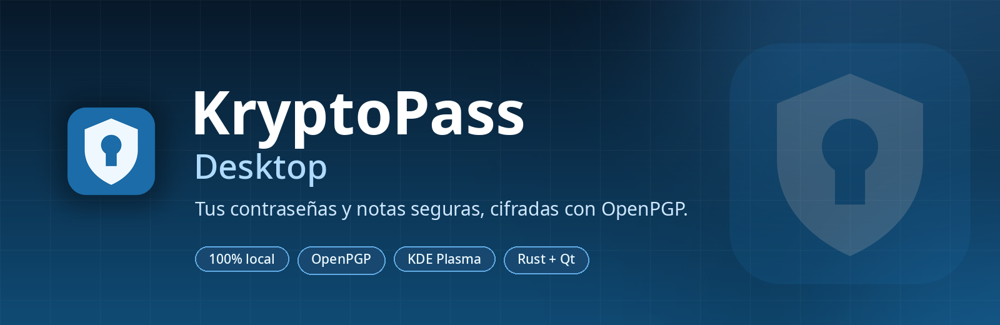
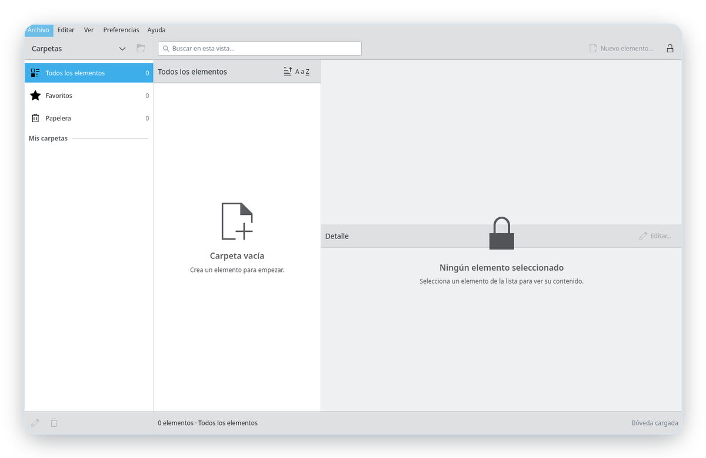
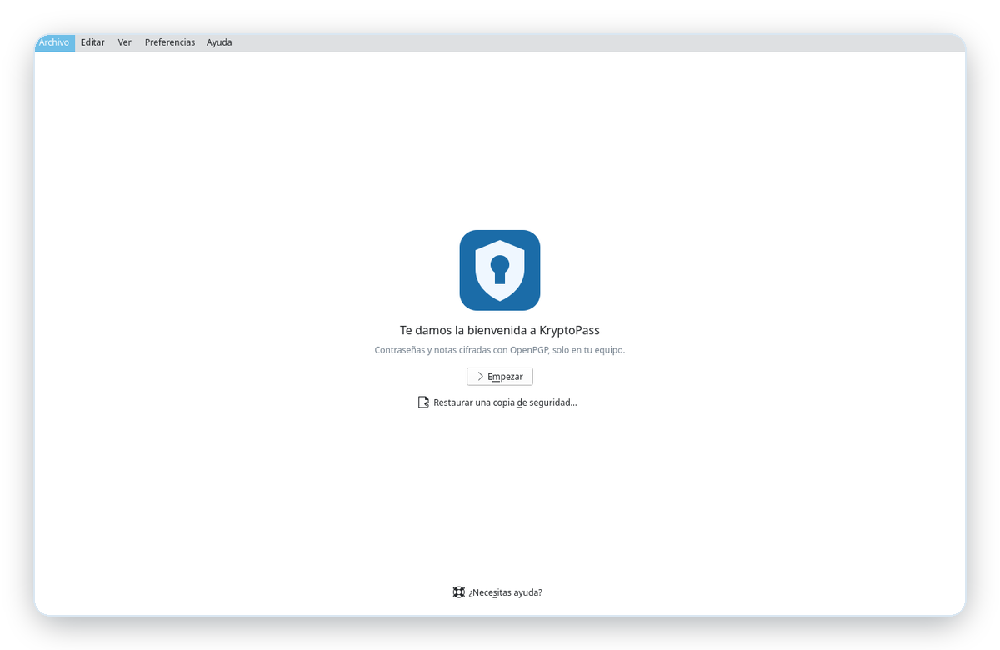
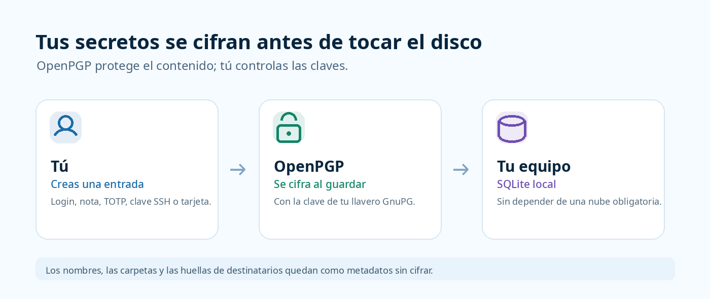
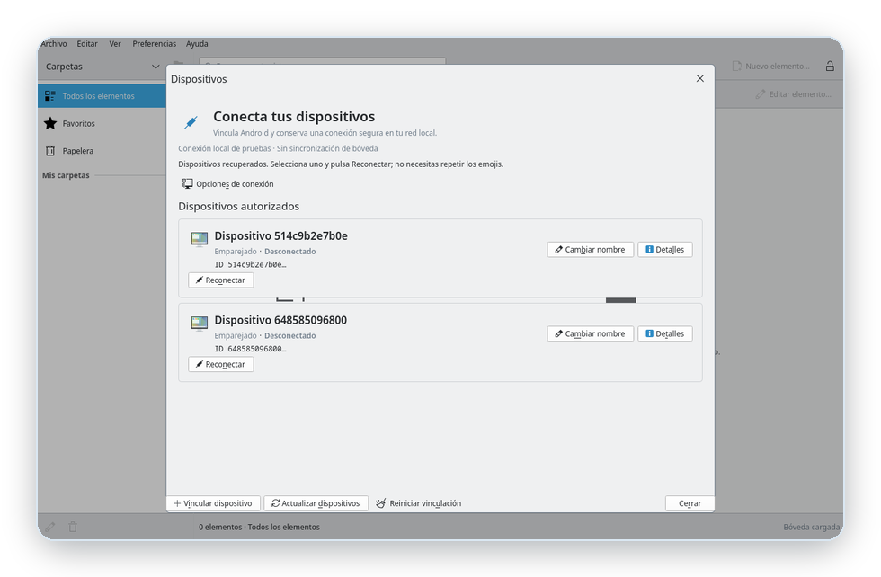

<!--
SPDX-FileCopyrightText: 2026 KryptoPass contributors
SPDX-License-Identifier: GPL-3.0-or-later
-->

<div align="center">
  
</div>

<p align="center">
  <a href="https://github.com/KryptoPass/KryptoPass/releases"></a>
  <a href="https://develop.kde.org/frameworks/kirigami/"></a>
  <a href="https://api.reuse.software/info/github.com/KryptoPass/KryptoPass"></a>
  <a href="COPYING"></a>
</p>

<h3 align="center">Tu bóveda personal, cifrada con OpenPGP y sin salir de tu equipo.</h3>

<p align="center">
  KryptoPass Desktop organiza contraseñas, notas y códigos de verificación en una
  aplicación nativa de KDE. El contenido sensible se cifra antes de guardarse y las
  claves viven en tu llavero de GnuPG.
</p>

<p align="center">
  <a href="https://github.com/KryptoPass/KryptoPass/releases"><b>Descargar la última release</b></a>
  ·
  <a href="BUILD.md">Compilar desde el código</a>
</p>

---

## Un vistazo

<table>
  <tr>
    <td width="50%"></td>
    <td width="50%"></td>
  </tr>
  <tr>
    <td align="center"><sub><b>Una bóveda, tres paneles.</b> Carpetas, búsqueda y detalle sin perder el contexto.</sub></td>
    <td align="center"><sub><b>Empieza en segundos.</b> Crea una clave dedicada o restaura una copia cifrada.</sub></td>
  </tr>
</table>

## Todo lo que guardas, en su sitio

KryptoPass no es solo un listado de contraseñas. Reúne en una misma bóveda
logins, notas, códigos TOTP, claves SSH, redes Wi-Fi, tarjetas, identidades,
licencias y campos personalizados. Organiza todo en carpetas, marca favoritos,
recupera versiones anteriores y encuentra un login al instante con la búsqueda
privada en memoria.

- **Generador de contraseñas** y códigos de verificación siempre a mano.
- **Copias de seguridad cifradas** en un único archivo `.kpb`, con restauración
  y selección de destinatarios.
- **Importación desde Proton Pass**, con un flujo que conserva lo que puede y te
  avisa de lo que no.
- **Portapapeles sensible** con borrado automático.

## Seguridad que no depende de una nube



Tú creas la entrada, OpenPGP la cifra con tu clave de GnuPG y el resultado se
guarda en una base SQLite local. KryptoPass no necesita subir tus secretos a
ningún servidor para funcionar.

> Los nombres, las carpetas y las huellas de destinatarios quedan como metadatos
> sin cifrar. Es una decisión de diseño para poder organizar y buscar la bóveda
> antes de desbloquearla.

La bóveda se bloquea al bloquear la sesión, al suspender el equipo o tras un
periodo de inactividad. El acceso del navegador y las lecturas pendientes se
invalidan al bloquear.

## Hecho para sentirse en casa en KDE Plasma

- Atajos configurables con **KXMLGUI** y el diálogo nativo de KDE.
- **KIO** para mostrar los respaldos en el gestor de archivos que uses.
- Tema, iconos y controles **Kirigami** que siguen a tu escritorio.
- Manual sin conexión con **KDocTools** y diálogo «Acerca de» nativo.
- Ventanas adaptables: la composición pasa de tres paneles a uno en ventanas
  estrechas sin perder el editor ni la selección.

## Tus dispositivos, conectados con cuidado

KryptoPass Desktop incluye integración con el navegador y vinculación con la app
Android mediante **Noise XX**, **SAS** y confianza persistente. La reconexión de
dispositivos ya autorizados no vuelve a pedir el QR ni el SAS.



<p align="center"><sub><b>Reconectar sin repetir el ritual.</b> Los dispositivos autorizados conservan su confianza.</sub></p>

Sync entre dispositivos, el transporte por Internet y la transferencia de la
identidad OpenPGP al teléfono están en fase de laboratorio. No se presentan como
una función auditada para producción.

## Estado

> [!IMPORTANT]
> KryptoPass Desktop está en desarrollo (0.1.0). La bóveda, la importación, los
> respaldos y la integración de escritorio son utilizables. La vinculación con
> Android, el transporte por Internet y Sync son laboratorio y no deben
> considerarse auditados para producción. La transferencia de la identidad
> OpenPGP al teléfono está limitada al modo debug y sigue pendiente de una
> revisión de seguridad independiente.

KryptoPass es un proyecto independiente y no forma parte oficial de KDE.

## Compilar y ejecutar

Requisitos, dependencias y detalles de empaquetado: [BUILD.md](BUILD.md).

```bash
just build       # compila el binario de desarrollo
just run         # abre la aplicación
just install     # instala en ~/.local
just verify      # puerta local: formato, Clippy, lint QML, pruebas y metadatos
```

Para distribuciones, el proyecto usa el flujo estándar de CMake/KDE:

```bash
cmake -B build -DCMAKE_INSTALL_PREFIX=/usr
cmake --build build
```

Las releases incluyen el tarball de fuentes y un árbol instalable para Arch
Linux x86_64; no son paquetes portables para otras distribuciones.

## Enlaces

- [Compilación y empaquetado](BUILD.md)
- [Releases](https://github.com/KryptoPass/KryptoPass/releases)
- [Incidencias](https://github.com/KryptoPass/KryptoPass/issues)
- [Procedencia y licencias](REUSE.toml)

## Contribuir

Las contribuciones son bienvenidas mediante incidencias y pull requests. Antes
de enviar un cambio, ejecuta `just verify` y `just ready`; las recetas están
descritas en [BUILD.md](BUILD.md). Los mensajes de commit siguen
[Conventional Commits](https://www.conventionalcommits.org/).

Las releases se publican solo al empujar una etiqueta `v<versión>` que coincida
con `Cargo.toml`. Los commits normales no generan releases.

## Licencia

KryptoPass Desktop se distribuye bajo [GPL-3.0-or-later](COPYING). Los metadatos
de AppStream usan CC0-1.0. La procedencia de cada archivo se declara en
[REUSE.toml](REUSE.toml) y se comprueba con `just licenses`.
