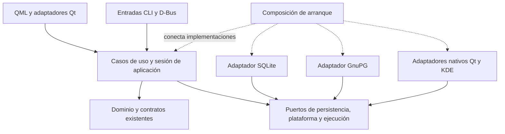

# KryptoPass Desktop: revisión de arquitectura

Fecha: 2026-10-24. Estado: R01 y R03 corregidos en la primera tanda;
hallazgos arquitectónicos pendientes de resolución.

Revisión estática del árbol de trabajo, con HEAD
`b71dcfcba6e4f63dce02b82ef9a82b6295a103ab` como referencia. El árbol tenía
cambios concurrentes; este informe no representa exclusivamente ese commit.
Se revisaron manifiestos, composición Desktop, almacenamiento, búsqueda,
backups y conexión con el laboratorio. La revisión inicial no ejecutó
suites ni reprodujo las carreras en la aplicación. Las comprobaciones de
la primera tanda se registran por separado.

## Diagnóstico

El proyecto tiene bibliotecas de dominio y servicios independientes de Qt.
La debilidad principal está en cómo Desktop los compone: parte de los casos
de uso vive en QObjects y QML, varios subsistemas mantienen su propia noción
de bóveda activa y hay dependencias de módulos en ambas direcciones.
Eso hace que una transición de aplicación requiera coordinar detalles de
persistencia, autorización, presentación y ejecución en varios lugares.

La clasificación siguiente identifica problemas de límites, propiedad y
colaboración entre componentes. El tamaño de un archivo, por sí solo, no es
el criterio. Las prioridades expresan impacto arquitectónico, no una
medición de frecuencia de fallos.

| ID | Prioridad | Hallazgo | Atributo afectado |
| --- | --- | --- | --- |
| A01 | Alta | Frontera de aplicación incompleta, alojada en adaptadores | Reutilización y capacidad de probar flujos |
| A02 | Alta | Contexto de bóveda ambiental y autoridad fragmentada | Consistencia de transiciones y aislamiento |
| A03 | Alta | Dependencias cíclicas entre módulos de Desktop | Sustituibilidad y evolución independiente |
| A04 | Media | La vista sirve de intermediaria entre servicios de backend | Consistencia de proyecciones y entradas alternativas |
| A05 | Media | Laboratorio acoplado al build ordinario de Desktop | Aislamiento de funcionalidades y reproducibilidad |
| A06 | Media | Contrato de ejecución y cierre repartido entre adaptadores | Control de recursos y mantenimiento del ciclo de vida |

## A01. Frontera de aplicación incompleta, alojada en adaptadores

**Evidencia.** `SecretsController` decide cómo abrir almacenamiento y crear
`SecretsService<SqliteStorage, GnuPgOpenPgp>`; también ejecuta el cambio de
bóveda, verifica el acceso, coordina snapshots y publica resultados. QML
mantiene las exclusiones entre operaciones de distintos controladores y la
secuencia de transición. La CLI sintética reutiliza una operación a través
de `ui_adapters::synthetic_sync`. [S01], [S02], [S03], [S04].

**Problema de arquitectura.** Existe un núcleo de dominio reutilizable,
pero no una frontera independiente de Qt que reúna el flujo completo de
aplicación. Presentación, coordinación de casos de uso y selección de
adaptadores concretos comparten componentes. Añadir otra entrada exige
reutilizar un módulo de UI o reconstruir su coordinación.

**Consecuencia.** Probar una transición completa o exponerla por CLI/D-Bus
arrastra decisiones de presentación. Una nueva operación debe integrarse
tanto en los controles de exclusión de QML como en los estados de Rust.
Extraer métodos a más archivos del mismo controlador no cambia ese límite.

**Dirección propuesta.** Introducir servicios de aplicación independientes
de Qt para los flujos que cruzan componentes, comenzando por la sesión de
bóveda. Componer almacenamiento, OpenPGP y ejecución en el arranque. Los
adaptadores QML y las entradas alternativas traducen comandos y resultados.
Esto puede empezar dentro del monolito, sin crear un crate por cada clase.

**Criterio de salida.** El flujo de activar y bloquear una bóveda puede
invocarse sin construir un QObject; sus exclusiones no dependen de
`Main.qml`. La UI conserva sus guardas de navegación y borradores.

## A02. Contexto de bóveda ambiental y autoridad fragmentada

**Evidencia.** `open_storage()` resuelve la ruta activa desde preferencias
en cada apertura. Búsqueda mantiene `ACCESS` global; navegador mantiene
`VAULT` global; el proveedor de iconos mantiene otro `STORE` con ruta y
scope. El controlador tiene sus propios flags y generaciones. Son estados
de subsistemas distintos, pero su cambio se coordina manualmente.
[S05], [S06], [S07], [S08].

La transición concreta persiste la ruta antes de configurar el navegador,
que aún puede fallar. La revisión inicial también encontró que cambiar de
bóveda no invalidaba la generación de desbloqueo; R01 se corrigió en la
primera tanda. La autoridad fragmentada y R02 siguen pendientes.
[S02], [S09], [S10].

**Problema de arquitectura.** La identidad de la sesión se obtiene de
estado ambiental y se replica sin un único propietario de la transición.
Una operación puede capturar una clave en un momento y resolver la ruta en
otro. Tener mutexes en cada subsistema no garantiza consistencia entre ellos.

**Dirección propuesta.** Un propietario de sesión entrega un contexto
explícito con identidad de bóveda, ruta fijada y generación de autorización.
Las operaciones usan ese contexto; los subsistemas reciben notificaciones
o capacidades derivadas. La preferencia persistida sirve para seleccionar
el siguiente arranque, no como localizador que cambia durante una operación.

Preparar los adaptadores antes de confirmar la transición y definir qué
estado queda publicado si falla un paso. No se necesita una transacción
SQLite que abarque todo: sí un protocolo de transición y recuperación.
Este propietario no debe convertirse en un modelo global de secretos.

**Criterio de salida.** Un resultado de A no puede publicarse en la sesión
de B. Un fallo al preparar B deja una sesión coherente y un resultado que
describe el estado persistido real.

## A03. Dependencias cíclicas entre módulos de Desktop

**Evidencia.** Hay dos ciclos concretos:

```text
storage -> backup -> storage
  storage/validation.rs importa presupuestos de backup;
  backup/format/mod.rs importa EncryptedStoreSnapshot de storage.

infrastructure -> ui_adapters -> infrastructure
  infrastructure/entry_icons.rs llama a ui_adapters::native_ffi;
  ui_adapters/secrets_controller.rs usa infraestructura OpenPGP e iconos.
```

También existe el recorrido `backup -> infrastructure -> ui_adapters`:
validar imágenes de un backup termina en el bridge nativo situado bajo UI.
[S11], [S12], [S13], [S14], [S15].

**Problema de arquitectura.** Los directorios no establecen una dirección
de dependencias. Persistencia conoce límites de un formato de exportación;
infraestructura conoce un módulo de presentación. Cambiar o extraer un
adaptador obliga a arrastrar componentes de otras responsabilidades.

El grafo de dependencias normales entre los 16 paquetes Cargo es acíclico.
Estos ciclos son internos a `kp-desktop`; no son ciclos entre crates ni
errores del compilador.

**Dirección propuesta.** Separar invariantes del almacenamiento de
presupuestos de exportación; dar a los snapshots un contrato independiente
del repositorio SQLite; colocar el bridge nativo en un adaptador de
plataforma y suministrar validación de imágenes mediante un límite explícito.
Qt puede seguir siendo la implementación elegida del decodificador.

**Criterio de salida.** Persistencia no importa backup; infraestructura no
importa presentación. Los casos de uso dependen de contratos y los
adaptadores concretos se conectan desde la composición.

## A04. La vista sirve de intermediaria entre servicios de backend

**Evidencia.** El catálogo sigue este recorrido:

```text
snapshot Rust -> SecretsController.entryRecords/folderRecords
             -> SecretStore.qml
             -> SearchController.setCatalog(...)
             -> deserialización Rust -> servicio kp-search
```

`SecretStore.qml` llama a `setCatalog` cuando cambian entradas o carpetas y
usa un timer para observar la generación de búsqueda. `SearchController`
reconstruye registros tipados desde las cadenas JSON. [S16], [S17].

**Problema de arquitectura.** La UI participa en la integración entre dos
componentes de backend. La sincronización del catálogo depende del cableado
de la vista, aunque su información nace en Rust. El problema supera el
formato JSON: cambiar a otra representación sin cambiar ese recorrido
mantendría la dependencia.

**Consecuencia.** Otra entrada o vista debe reproducir esta conexión para
mantener el catálogo. Los contratos de presentación pasan a ser también
contratos internos entre servicios.

**Dirección propuesta.** Publicar cambios de metadatos desde aplicación y
actualizar la búsqueda en Rust mediante un contrato tipado. Mantener las
etiquetas traducidas como una proyección explícita del adaptador. QML
observa el catálogo y los resultados, sin retransmitir el snapshot completo.

**Criterio de salida.** La actualización del catálogo funciona sin
instanciar `SecretStore.qml`. La autorización sigue en Rust: el mecanismo
actual de grants de búsqueda ya es independiente de los observadores QML
y debe conservarse. [S06].

## A05. Laboratorio acoplado al build ordinario de Desktop

**Evidencia.** `kp-pairing-lab` y sus dependencias aparecen como dependencias
normales, no opcionales, de Desktop. El build registra siempre su
controlador y `DevicesWindow.qml`. Todo build con `PROFILE=debug` prepara
o valida la fixture sintética; si esa preparación falla, falla el build
de Desktop. El controlador limita su disponibilidad con guardas debug.
[S18], [S19], [S20].

**Problema de arquitectura.** La frontera de disponibilidad en ejecución
no coincide con la frontera de composición y construcción. Una actividad
que no usa el laboratorio sigue dependiendo de su preparación en debug.
La cantidad de dependencias del ejecutable no es por sí sola un defecto;
este acoplamiento concreto sí introduce una condición de build transversal.

**Dirección propuesta.** Elegir una frontera explícita de laboratorio:
feature con dependencias opcionales y registros QML/build condicionales, o
un ejecutable de laboratorio que comparta los servicios reutilizables.
Decidirlo según qué funcionalidades de dispositivos vayan al producto.
Conservar el aislamiento de perfiles y las guardas existentes.

**Criterio de salida.** Construir y usar Desktop sin laboratorio no requiere
preparar su fixture. La variante de laboratorio sigue siendo explícita y
reutiliza protocolo y servicios, sin duplicarlos.

## A06. Contrato de ejecución y cierre repartido entre adaptadores

**Evidencia.** `qt::jobs::run_blocking()` crea un thread por llamada y
devuelve `()`, sin un handle de operación. Pairing implementa además
threads, runtimes Tokio, canales de cancelación, generaciones y espera de
drenado en su controlador. Ya existe un propietario de proceso reutilizable
en `kp-pairing-lab`; la UI mantiene coordinación adicional sobre él.
[S21], [S22], [S23].

**Problema de arquitectura.** El contrato para admitir trabajo, invalidar
resultados, cancelar y cerrar se define de nuevo en cada adaptador. Las
operaciones no comparten una representación explícita de sus ámbitos de
vida: proceso, sesión de bóveda y solicitud.

**Consecuencia.** Cada caso nuevo debe acertar con su combinación de
generación, flag, canal y callback Qt. Es fácil que invalidar una vista y
cancelar un efecto se interpreten como la misma operación, aunque tengan
semánticas diferentes.

**Dirección propuesta.** Dar a los servicios de aplicación handles de
operación y ámbitos de vida explícitos. Definir por operación qué se puede
cancelar, qué escritura puede terminar y cuándo se descarta una publicación.
El adaptador Qt solo entrega resultados al event loop. Reutilizar los
owners existentes donde encajen; no hace falta imponer un único runtime
para todos los trabajos.

**Criterio de salida.** Cerrar una vista, bloquear una bóveda y terminar el
proceso tienen políticas distintas y verificables. Los nuevos adaptadores
consumen ese contrato sin reconstruir el protocolo de cierre.

## Dirección de dependencias propuesta

Este esquema representa una propuesta de límites, no módulos ya creados:



El ejecutable puede seguir siendo un monolito modular. Las implementaciones
actuales de `Storage` y `OpenPgp` en `kp-core`, el servicio independiente
`kp-search` y la inyección de crypto en `kp-vault` son puntos de apoyo para
esta dirección. No se propone introducir red entre componentes locales.

## Orden de intervención

1. Corregir R01–R03 y definir la transición de sesión de A02. Esas
   correcciones puntuales no tienen que esperar una extracción de capas.
2. Mover el flujo de sesión detrás de una API de aplicación independiente
   de Qt, manteniendo el comportamiento de los adaptadores actuales.
3. Romper los ciclos de A03 y conectar catálogo/búsqueda sin la vista.
4. Aislar el laboratorio y consolidar el contrato de ejecución por ámbitos.

Cada paso debe producir un límite comprobable. Si se añaden chequeos de
arquitectura, deben integrarse en `justfile` y `bacon.toml`, conforme a la
guía del repositorio; este informe no añade comandos ni gates nuevos.

## Decisión futura que no se clasifica como defecto actual

La bóveda local usa registros mutables con revisión escalar; `SyncedVault`
trabaja sobre un ledger firmado con múltiples heads y tombstones. Hoy la
prueba sintética está aislada deliberadamente de la bóveda normal.
[S24], [S25]. Esa coexistencia no demuestra por sí sola duplicación errónea.

Antes de integrar Sync de producción conviene documentar qué sistema será
la autoridad de escritura, qué representación será una proyección y cómo
se preservarán carpetas, enlaces, destinatarios y conflictos. Conectar dos
escrituras independientes sin esa decisión introduciría otro problema de
autoridad. Este informe no habilita ni declara aceptada esa integración.

## Registro de los siete hallazgos anteriores

Se conservan a petición del usuario. Son observaciones de implementación y
diseño que motivan parte del análisis arquitectónico; no sustituyen los
límites descritos arriba. La tabla conserva la observación inicial y
registra por separado su estado actual.

| ID | Prioridad | Observación registrada | Evidencia | Relación | Estado |
| --- | --- | --- | --- | --- | --- |
| R01 | P1 | Cambiar de bóveda no invalidaba `unlock_operation`; un resultado de A podía desbloquear el estado de B. Carrera inferida, sin reproducción. | [S02], [S09] | A02, A06 | Corregido en primera tanda |
| R02 | P1 | La ruta nueva se persiste antes de configurar navegador; un error posterior puede dejar ruta nueva y UI anterior mientras el mensaje afirma que no cambió. | [S10] | A02 | Pendiente |
| R03 | P2 | Privacidad escribía los campos antes de llamar a sus setters; la comparación por igualdad impedía emitir `NOTIFY`. También ocurría al cargar preferencias. | [S26], [S31] | Contrato del adaptador Qt | Corregido en primera tanda |
| R04 | P2 | Preferencias de clave principal abren y escriben SQLite en el hilo Qt; la conexión configura un busy timeout de cinco segundos. Riesgo de bloqueo, sin medición de latencia. | [S27], [S28] | A01, A06 | Pendiente |
| R05 | P2 | Buscar metadatos por ID carga el snapshot completo dos veces al abrir detalle; la lectura añade una consulta de destinatarios por entrada. | [S29], [S30] | Contrato de lectura demasiado amplio | Pendiente |
| R06 | P3 | Los controladores de secretos y pairing acumulan responsabilidades y estados. El tamaño es un indicio; el problema es la mezcla de roles. | [S01], [S22] | A01, A06 | Pendiente |
| R07 | P3 | Metadatos públicos se serializan, interpretan en QML y se interpretan otra vez en Rust; los fallos de parseo se descartan o devuelven `null`. | [S16], [S17] | A04 | Pendiente |

Para R03, la revisión inicial contrastó la comparación por igualdad con
el generador CXX-Qt. La implementación concreta de estas propiedades es
la macro local `notifying_property!`, que solo asigna y notifica cuando
el valor cambia. La causa y la corrección son las mismas. [S31].

## Primera tanda: R01 y R03

- R01: `set_active_vault()` llama a `cancel_unlock()` antes de limpiar el
  estado sensible y comenzar la activación. Esto incrementa la generación
  y quita el indicador de desbloqueo pendiente; el callback anterior ya
  comprueba esa generación y descarta su resultado.
- R03: se eliminaron las seis asignaciones directas previas a los setters,
  tanto al cargar preferencias como al guardar cambios de privacidad.
  Los setters existentes actualizan el campo y emiten su notificación.

La primera tanda no resuelve A01–A06 ni la transición parcial de R02.
No cambia contratos Android ni el protocolo de red.

Validación de la tanda: en curso.

## Comprobaciones de la revisión inicial

- Lectura de contratos y llamadas concretas para cada hallazgo.
- Inspección de las dependencias normales de los 16 manifiestos Cargo:
  grafo acíclico; `kp-desktop` tiene 13 dependencias locales directas.
- Inspección de los ciclos internos indicados; no se dedujeron únicamente
  del nombre o tamaño de los archivos.
- Validación de destinos y líneas de las referencias de este documento y
  revisión de whitespace del archivo añadido.
- Durante la revisión inicial solo se añadió este informe. No se ejecutaron
  compilación, lint de producto, tests, benchmarks ni gates de aceptación.

## Referencias al código inspeccionado

Las líneas corresponden al árbol leído el 2026-10-24 y pueden desplazarse
con cambios posteriores.

[S01]: ../../crates/kp-desktop/src/ui_adapters/secrets_controller.rs#L2626
[S02]: ../../crates/kp-desktop/src/ui_adapters/secrets_controller.rs#L536
[S03]: ../../crates/kp-desktop/ui/qml/Main.qml#L92
[S04]: ../../crates/kp-desktop/src/main.rs#L127
[S05]: ../../crates/kp-desktop/src/ui_adapters/secrets_controller.rs#L2676
[S06]: ../../crates/kp-desktop/src/search/access.rs#L28
[S07]: ../../crates/kp-browser/src/lib.rs#L29
[S08]: ../../crates/kp-desktop/src/infrastructure/entry_icons.rs#L19
[S09]: ../../crates/kp-desktop/src/ui_adapters/secrets_controller.rs#L628
[S10]: ../../crates/kp-desktop/src/ui_adapters/secrets_controller.rs#L2669
[S11]: ../../crates/kp-desktop/src/storage/validation.rs#L3
[S12]: ../../crates/kp-desktop/src/backup/format/mod.rs#L15
[S13]: ../../crates/kp-desktop/src/infrastructure/entry_icons.rs#L73
[S14]: ../../crates/kp-desktop/src/ui_adapters/secrets_controller.rs#L18
[S15]: ../../crates/kp-desktop/src/backup/format/validation.rs#L173
[S16]: ../../crates/kp-desktop/ui/qml/SecretStore.qml#L59
[S17]: ../../crates/kp-desktop/src/ui_adapters/search_controller.rs#L174
[S18]: ../../crates/kp-desktop/Cargo.toml#L44
[S19]: ../../crates/kp-desktop/build.rs#L49
[S20]: ../../crates/kp-desktop/src/ui_adapters/pairing_lab_controller.rs#L268
[S21]: ../../crates/kp-desktop/src/qt/jobs.rs#L7
[S22]: ../../crates/kp-desktop/src/ui_adapters/pairing_lab_controller.rs#L329
[S23]: ../../crates/kp-pairing-lab/src/resume_owner.rs#L323
[S24]: ../../crates/kp-vault/src/lib.rs#L84
[S25]: ../../crates/kp-desktop/src/ui_adapters/synthetic_sync.rs#L1
[S26]: ../../crates/kp-desktop/src/ui_adapters/pairing_lab_controller.rs#L752
[S27]: ../../crates/kp-desktop/src/ui_adapters/secrets_controller.rs#L677
[S28]: ../../crates/kp-desktop/src/storage/connection.rs#L13
[S29]: ../../crates/kp-desktop/src/ui_adapters/secrets_controller.rs#L2558
[S30]: ../../crates/kp-desktop/src/storage/records.rs#L137
[S31]: ../../crates/kp-desktop/src/ui_adapters/pairing_lab_controller.rs#L2241
