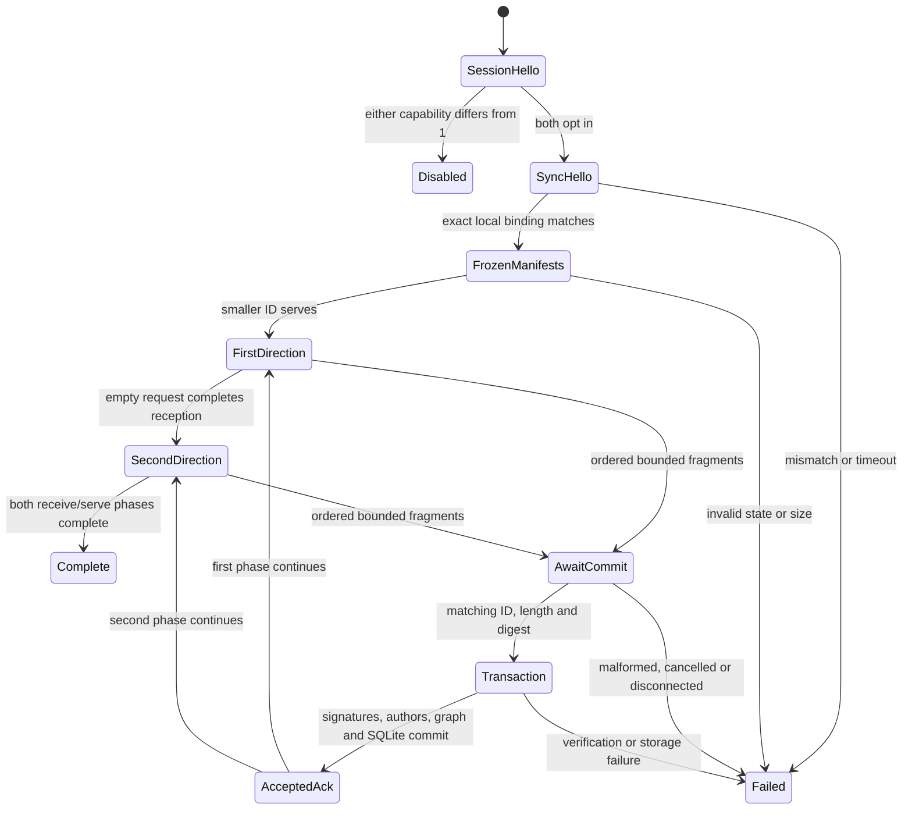

# Sync over an authenticated session — v1

This milestone adds an optional, explicitly supplied ledger binding to existing
session owners. It does not migrate current vaults or enable private-key export.
Default sessions advertise `SessionHello.sync_version = 0`; a configured owner
advertises 1. Run Sync only when both advertise 1. Other values disable Sync for
that connection. No Sync message is legal before the bilateral SessionHello.
Keepalives and close continue using the SAME Noise state and envelope sequence.
There must be exactly one receive owner, no second socket or session codec.

## Explicit local binding

The caller supplies an existing ledger, its existing trust source, authenticated
local/remote device identities and an expected OpenPGP fingerprint of 20 or 32
bytes. The peer must remain exactly trusted. No remote message may create a
ledger, choose the local vault ID, authorize an author, or replace identities.

After capability negotiation, both send SyncHello: vault_id from the ledger,
device_id from the authenticated LOCAL identity, known_revision_count bounded
by 10000, and openpgp_fingerprint (new field 4). Reject mismatching vault,
fingerprint, authenticated device, repeated Hello or unsupported state. Codec
may parse empty fingerprints for legacy compatibility; this engine requires
the locally configured exact fingerprint. Fingerprints identify a key; they do
not prove possession of the private key. Opaque encrypted changes may be stored
while a vault is locked. Author trust is explicit and non-transitive.

## One bounded round

At local start or on valid SyncHello, freeze a metadata index (max 10000), its
manifest (max 1024 heads) and a fresh random nonzero snapshot_id. Only immutable revisions present
in that index may be served; newly appended edits wait for a subsequent round.
Send SyncManifest. Reject duplicate revision IDs (including cross-record IDs),
invalid IDs/hashes and inconsistent heads already known locally.

Transfers are sequential by device ID to avoid full-duplex backpressure stalls:
the endpoint with the lexicographically SMALLER unsigned device ID SERVES first;
the larger endpoint REQUESTS first. Both still exchange Hello and Manifest.
The smaller endpoint saves the remote manifest but does not request yet.

The receiver requests up to 256 missing manifest heads in SyncRequest bound to
the REMOTE snapshot ID. A request's record/revision pairs must be unique and
belong to the sender's frozen manifest. On the sender, compute their ancestor
closure in the frozen index, topological order; exclude revisions already
acknowledged during this round. Bound all traversal by the index size. Transfer
this plan as batches of at most 32 revisions and 8 MiB encoded bytes. Load objects
on demand, validate their stored digests against the frozen index, do not retain
all ciphertext in the plan. Each next batch waits for its matching accepted ACK.

For each batch choose a fresh nonzero transfer_id, compute SHA-256 of the encoded
SyncRevisionBatch, send SyncChunk fragments of 48 KiB (last fragment shorter),
then SyncCommit. At most ONE outbound or ONE inbound data transfer is active
because of the serving order. Owners send at most one frame per loop and still
process pings, trust invalidation, close and cancellation between fragments.
Avoid a 250 ms receive poll per fragment: use a short/nonblocking poll while an
outbound frame is ready, normal bounded receive while idle.

Incoming chunks require an outstanding requested-head window, fresh transfer
ID, monotonically increasing chunk_index starting 0, exact ceil(total/48KiB)
count, constant total/digest and exact fragment sizes. Encoded transfer cap 8 MiB;
do not preallocate from an unchecked length. No unrelated record IDs may enter
the batch. Commit must match the active transfer ID/digest and require all
chunks. Verify digest, bounded batch codec, vault, signatures, authorized authors
and graph through the existing ledger insert transaction. Check every requested
head object present in a batch against its advertised hash BEFORE insert.
ACK_ACCEPTED is queued only AFTER the insertion commits. Storage failure sends
no successful ACK. A mismatching ACK, rejected ACK, unsolicited commit/chunk,
duplicate/out-of-order phase or missing dependency fails closed.

After each committed batch the receiver checks its requested window. When all
heads are present with the advertised hashes, request the next missing window.
After all manifest heads match, send an EMPTY SyncRequest for that snapshot.
It means receive phase complete, not a transfer. ACK must precede a next/empty
request in the output queue. Receiving an empty request ends the serving phase.
If the smaller endpoint has finished serving, it now requests its saved remote
manifest. The larger endpoint has already finished receiving and now serves.
After both phases finish the local progress state is complete. Empty ledgers
use the same empty request, without inventing transfers or acknowledgements.

## Failure and lifecycle

Each engine is scoped to one authenticated connection and one round. Use a
monotonic caller clock: idle transfer/request timeout 30 s; absolute round cap 300 s.
Bound inbound total objects to 10000 plus bounded exact duplicates if required;
the sender avoids re-sending ACKed ancestors. Bound control queues and plans,
discard in-flight buffers on close/cancel/error. Errors/progress diagnostics
contain fixed codes/counts only; no ciphertext, IDs, fingerprints or keys.
Unknown authors remain an error, never an automatic trust update.

Session loss discards partial transfer state. Completed transactions survive;
reconnecting performs fresh Noise, Hello, snapshot and missing-head comparison.
A lost ACK is safe: the already committed objects are discovered/idempotently
accepted on retry. No plaintext payload or private GPG key enters this engine.

This round's progress is observable in memory under the authenticated peer.
The ledger provides durable revision progress. A separate durable per-peer
receipt journal and automatic new rounds for live edits remain application
integration work; do not pretend volatile counts are persistent peer receipts.
Existing local vault adapters need an explicit reversible migration and atomic
edit/revision storage before configuring this extension for user credentials.

## Implementation boundaries

Rust engine belongs in kp-sync; optional owner support in kp-devices, with a
new explicit constructor/start function preserving existing defaults/callers.
Kotlin engine belongs in sync-core; optional debug owner binding through
DebugPairingController, supplied explicitly per authenticated peer. No new UI,
auto-selected vault or regenerated identities. Tests use synthetic isolated
ledgers, then the emulator. Independent security review remains paused.

## Effective API and current limits

Rust `SyncSession::new(ledger, Box<dyn TrustSource + Send>, local_device_id,
expected_peer, fingerprint, now)` owns its ledger and trust source.
`poll_output(now)` returns at most one `SyncOutbound`; `handle_message(type,
payload, now)` applies an authenticated input; `check_time`, `progress`,
`is_complete`, and `cancel` expose bounded lifecycle control. Errors are fixed
`SyncSessionError` variants. `kp-devices::SyncSessionBinding::new` and
`start_session_with_sync` opt in; the options variant preserves reconnect ports.
`SessionHandle::sync_progress()` returns volatile count-only progress. Ledger I/O
runs in a blocking worker with bounded queues. An extra pending frame applies
backpressure for up to 2 s while the owner keeps polling commands and outputs;
long storage stalls fail the session instead of growing memory indefinitely.
In-flight atomic transactions cannot be forcibly rolled back after commit.

Kotlin `SyncSession.Binding(ledger, trust, localDeviceId,
authenticatedPeerDeviceId, expectedPeerIdentity, expectedOpenPgpFingerprint)`
borrows existing objects. `start(1, remoteVersion)`, `onMessage(type,payload)`,
`poll()`, `tick()`, `hasPendingOutput()`, `progress()` and `close()` are the
engine API. Methods serialize engine access; run I/O outside the UI thread.
`DebugConnectionOwner.bindSyncLedger(peerId, DebugSyncLedgerBinding(...))`
configures only an already authorized peer with no active session. Keep its
ledger/trust open while bound. Disconnect, wait for that session to stop, then
`unbindSyncLedger` before releasing the store. Binding/unbinding during an
active session returns false. Forget/reset/shutdown clear these opt-ins, while
preserving vault data. A new round requires a new engine, usually on reconnect.

A manifest must also fit one protocol payload (65472 bytes). The structural
1024-head cap is not a promise that 1024 heads fit one frame. Oversized encoded
manifests fail explicitly; pagination is pending. No truncation is permitted.
Received/sent progress counts refer to objects transferred, including exact
ancestors already stored locally; ledger counts reflect unique revisions.
Keepalive/control traffic retains its existing 32-message/s budget. Sync control
has a separate 2048-message/s budget and data a 4096-message/s budget; exceeding
a bound fails the connection. The engine also limits phase/order, total objects,
transfer size and lifetime. These are resource limits, not throughput guarantees.

## Round states

The diagram's direction transitions are phase dependent. Committed objects
survive a failed round; an in-flight partial object is never a revision or ACK.
